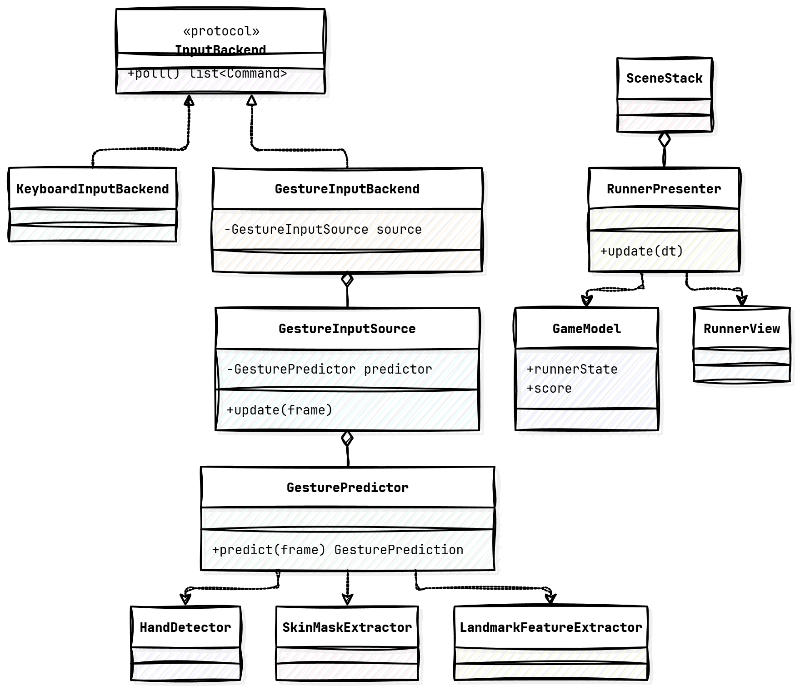
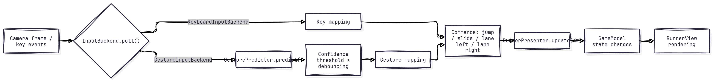
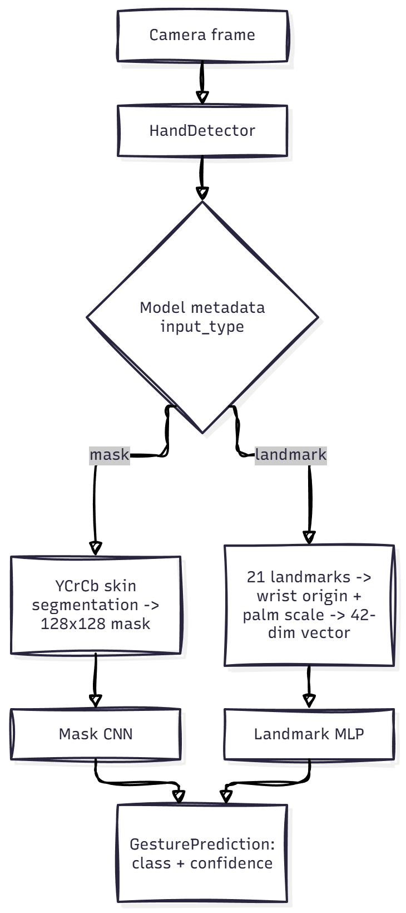
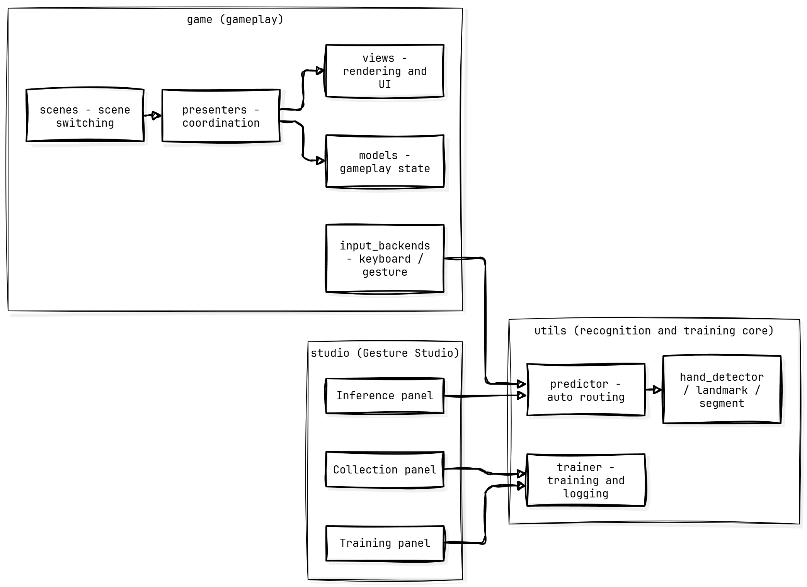
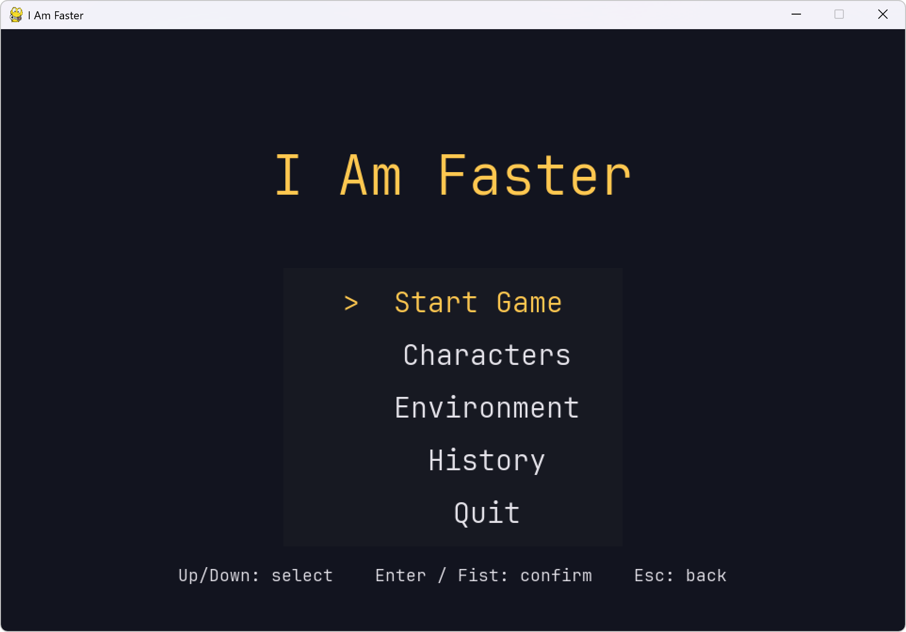
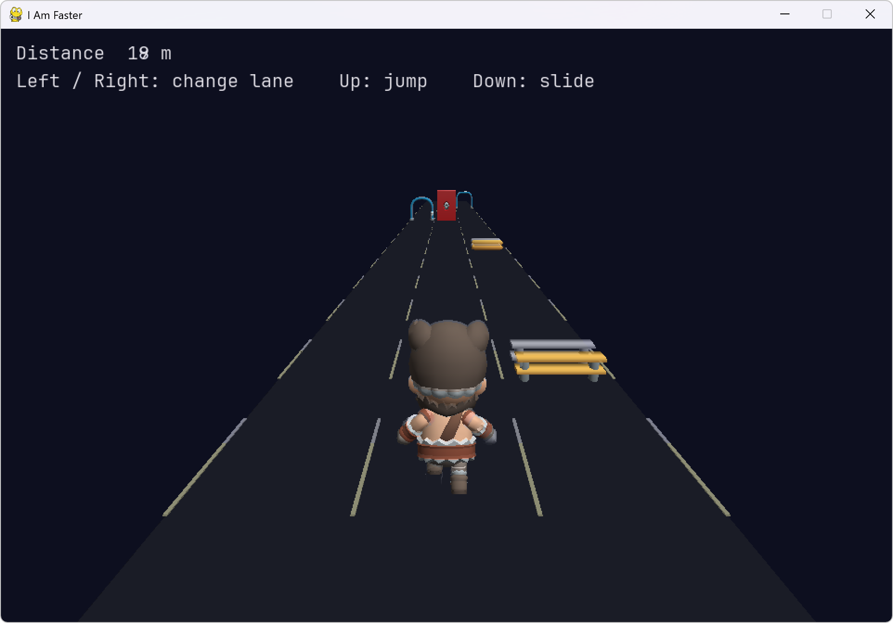
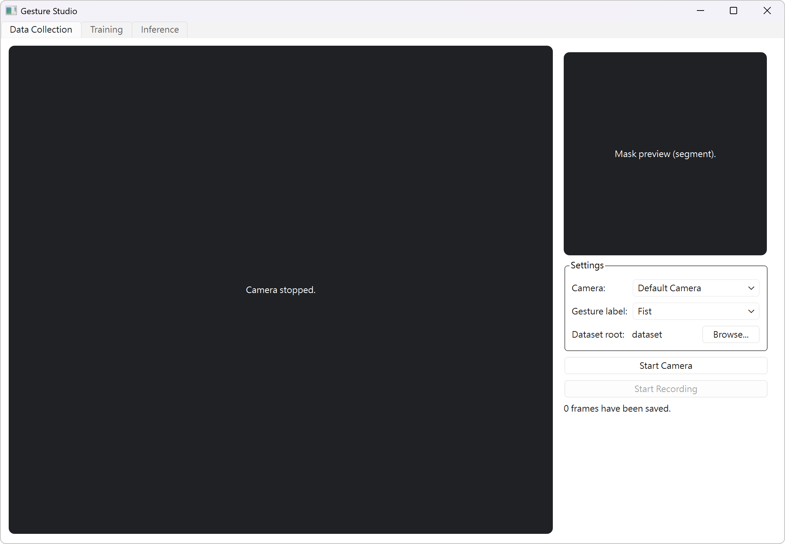
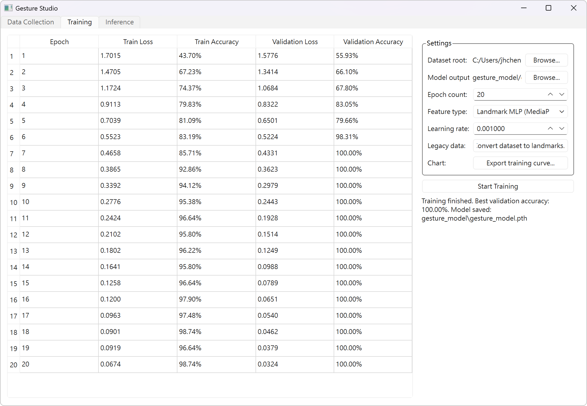
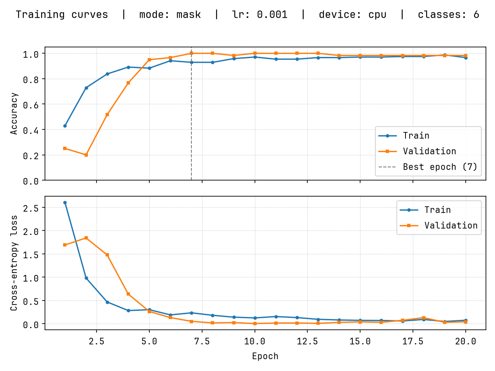
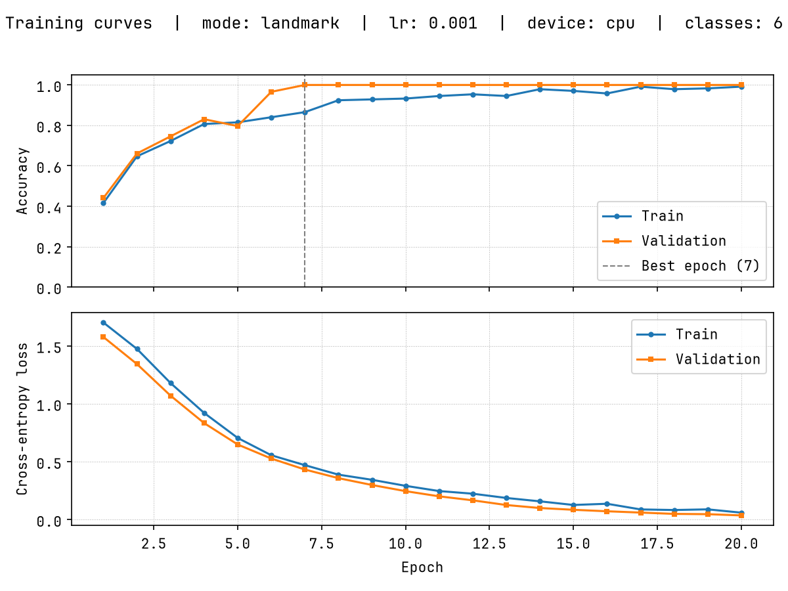

# IAmFaster：基于双路线手势识别的跑酷游戏技术报告

|          |                                          |
| -------- | ---------------------------------------- |
| 小组选题 | 基于双路线手势识别的跑酷游戏与训练工具链 |
| 小组成员 | 林颖哲  2024611129<br>黄 睿  2024612022  |
| 任课教师 | 陈泰舟                                   |
| 完成时间 | 2026 年 11 月                            |

汕头大学 数学与计算机学院 计算机系
2025-2026 学年 秋季学期

## 一、项目介绍

体感交互是人机交互的自然演进方向：相比键盘，手势不需要视线离开屏幕，也不依赖额外的物理设备；本项目选择跑酷游戏作为载体，是因为跑酷对输入实时性要求高 —— 跳跃、下滑、变道都需要在数百毫秒内完成响应，能够充分检验一条手势识别链路从摄像头采集、特征提取、模型推理到游戏响应的完整工程闭环

针对上述目标，本项目设计并实现了一个手势控制的跑酷游戏 IAmFaster 与配套训练工具链 Gesture Studio；游戏中，KayKit 3D 角色在无尽跑道上前进，玩家面对摄像头做出手向上 (跳跃)、手向下 (下滑)、手部左右移动 (变道)、握拳 (确认) 等手势，躲避障碍；同时保留键盘输入作为对照与备选；Gesture Studio 是独立的桌面程序，覆盖数据采集、模型训练与推理测试的完整闭环，使手势模型可以随环境、用户的差异持续迭代

项目的核心特色是手势识别实现了两条可替换的技术路线：基于肤色分割图像的 Mask CNN，与基于 MediaPipe 手部关键点的 Landmark MLP；两条路线共用同一预测接口，可在不修改任何游戏代码的情况下切换，并通过同一数据源完成了公平的对比实验

## 二、系统设计

### 2.1 总体架构

系统采用 Model-View-Presenter (MVP) 架构，游戏逻辑、渲染表现与输入来源三层彻底解耦；models 包保存全部玩法状态 (角色位置、速度、当前动作、障碍与分数)，不依赖任何渲染或输入代码，只暴露可查询的状态与状态变更方法；presenters 包接收轮询到的设备无关命令，把命令翻译为对 Model 的状态变更，并驱动每帧按固定子步推进碰撞检测与计分；views 包由 RunnerView 与 UiLayer 把 Model 状态绘制为画面；scenes 包由 SceneStack 管理主菜单、游戏中、结算等场景切换；数据流向为单向：输入 → Presenter → Model → View

> 
>
> 图 1：系统架构总图

### 2.2 输入后端与命令链路

输入层抽象为 InputBackend 协议，约定唯一的 poll() 接口，返回与具体来源无关的命令 (跳跃、下滑、左移、右移)；KeyboardInputBackend 轮询 Pygame 键盘事件并映射为命令；GestureInputBackend 内部持有 GestureInputSource，从摄像头取帧交给 GesturePredictor 识别，把手势映射为同一组命令，并带置信度阈值与防抖逻辑 (连续多帧一致才触发切换，无手帧自动释放当前手势)；两个后端实现同一协议、组装时注入给 Presenter，因此从键盘控制切换为手势控制只需替换一个实例，Model、Presenter、View 三层零改动；新增第三种输入源 (如体感手柄) 也只需再实现一个协议实现类

> 
>
> 图 2：输入命令流转图

### 2.3 输入后端与手势识别后端的切换逻辑

后端的切换发生在启动装配阶段，由 main.py 的命令行参数 --backend 决定，取值为 keyboard、gesture、both，默认为 keyboard (对应 game/input_backends/actions.py 中的 BACKEND_CHOICES 与 DEFAULT_BACKEND_NAME)；GameApp.run 按该取值组装出一个后端列表，主循环只面向这个列表轮询并把命令交给当前场景，因此 "切换后端" 在代码上等价于 "改一处列表组装分支"，场景、Presenter、Model、View 均不知道命令来自键盘还是摄像头

组装规则有三条：其一，键盘后端始终创建，但 enable_game_keys 仅在非 gesture 模式下为真，纯手势模式会关闭方向键映射、只保留 Esc→BACK 与 Enter→RESET；其二，后端名属于 {gesture, both} 时先校验模型文件是否存在，缺失即以 FileNotFoundError 终止启动，随后读取模型旁的 .classes.json 校验必需类别 {Left, Right, Up, Down}，缺类直接报错，避免能启动却永远不触发的哑故障；其三，手势后端通过 ExitStack 注册 close 回调，正常退出或异常退出都会停止预测线程并释放摄像头

手势到命令的映射在组装时以字典注入，游戏侧只认命令、不认手势名，因此增删手势只需改映射表

| 手势  | 命令  | 游玩中的含义     | 菜单与结算中的含义 |
| ----- | ----- | ---------------- | ------------------ |
| Up    | JUMP  | 跳跃越过栏架     | 选择上移           |
| Down  | SLIDE | 下滑穿过横杆     | 选择下移           |
| Left  | LEFT  | 向左变道         | 选择上移           |
| Right | RIGHT | 向右变道         | 选择下移           |
| Fist  | RESET | 结算后重开       | 确认               |
| Palm  | —     | 未映射，保留类别 | —                  |

手势链路内部还有第二层切换，即从 "逐帧预测" 切换为 "离散手势事件"，由 GestureInputSource 的防抖状态机完成：后台线程约每 5 ms 取一帧并推理，结果先经置信度阈值 0.25 过滤；同一类别连续 3 帧达标才被确认，低于阈值 (包括 HandNotDetectedError，被折算成零置信度预测) 连续 3 帧则清空待定与已确认状态，使 "手离开画面" 等价于释放当前手势；确认后的手势只触发一次事件 (游戏侧未启用可重复类别)，换手势必须先释放再重新确认，从而避免单帧误识别引发连续误动作

模型路线的切换与前两者相互正交：输入后端决定 "命令从哪来"，模型路线决定 "手势怎么认"；GesturePredictor 构造时读取模型旁 .meta.json 的 input_type，据此进入肤色分割 CNN 分支或关键点 MLP 分支，所以换路线只需换 --model-path，两条路线都能与 keyboard、gesture、both 自由组合；由于路线、输入维度与类别表都由元数据自我描述，游戏端不需要任何 "如果是某某模型则……" 的判据

### 2.4 双路线手势识别设计

GesturePredictor 对游戏侧只暴露 predict (frame) 这一入口；Mask 路线对裁剪手部图像做 YCrCb 肤色阈值分割，取最大连通域得到 128×128 单通道图，送入卷积网络分类；Landmark 路线基于 MediaPipe hand landmarker 提取 21 个关键点，以腕部为原点、掌宽为尺度归一化得到 42 维特征，消除平移、缩放与距离影响后送入小规模 MLP；加载模型时读取模型文件旁的元数据 (input_type) 自动选择路线 —— 切换路线等于换一个模型文件路径，调用方无感

> 
>
> 图 3：双路线识别流程图

### 2.5 训练工具链设计

训练侧与游戏侧共用识别核心但完全解耦：ModelTrainer 只依赖 PyTorch 的 Dataset 协议，两种路线各自实现数据集类 (读裁剪图与读特征向量)，训练循环、验证划分、checkpoint 保存逻辑完全复用；Gesture Studio 的采集面板一帧同时落盘裁剪图 (jpg) 与关键点特征 (npy) 两套数据，保证两条路线使用同一数据源、对比实验公平；训练面板支持特征路线、epoch 与学习率调节；每个模型保存时附带元数据 (路线类型、输入维度、类别表)，既是推理端自动路由的依据，也保证了模型文件的自我描述性

## 三、使用说明

### 3.1 环境准备与启动

运行环境为 Windows 10/11、Python 3.13+ 与一个可用摄像头 (Windows 下摄像头统一通过 DirectShow 后端打开)；依赖版本由 uv 锁定，首次使用执行

```bash
uv sync
```

首次以手势方式运行时会自动下载 MediaPipe hand_landmarker 模型到 assets/models/，无需手工准备

游戏入口为 main.py，常用启动方式如下

```bash
# 键盘模式(默认)
uv run python main.py

# 纯手势模式
uv run python main.py --backend gesture --model-path gesture_model/snapshot/gesture_best.pth

# 键盘与手势同时生效，便于对照与过渡
uv run python main.py --backend both --model-path gesture_model/snapshot/gesture_best.pth

# 多摄像头机器上指定设备
uv run python main.py --backend gesture --model-path gesture_model/snapshot/gesture_best.pth --camera-name "USB Camera"
```

三个参数的约定：--backend 取 keyboard、gesture、both；--model-path 指向 .pth 模型文件，同目录必须存在同名的 .classes.json 与 .meta.json (训练面板保存模型时会一并写出)，缺省值为 gesture_model/gesture_model.pth，仓库内的实际产物位于 gesture_model/snapshot/，因此手势游玩请显式指定；--camera-name 缺省时取第一个可用设备；gesture 与 both 模式下若模型缺失、或类别缺少 Left、Right、Up、Down 中的任意一个，程序会直接报错退出而不进入菜单，这是有意的启动期校验

训练工具 Gesture Studio 的入口为 studio.py

```bash
uv run python studio.py
```

使用顺序为 Data Collection (选择摄像头与手势标签、录制，每帧同时保存裁剪图与关键点特征) → Training (选择特征路线、epoch 与学习率，模型、类别表、元数据与 JSONL 训练日志输出到 snapshot/) → Inference (加载任意模型查看实时识别与置信度)

### 3.2 界面与操作

主菜单包含 Start Game、Characters、Environment、History、Quit 五个入口，所有界面共用一套导航方式：Up 或 Left 上移、Down 或 Right 下移、Enter 或握拳确认、Esc 返回上一级；纯手势模式下方向键被禁用，但 Esc 与 Enter 仍保留，避免摄像头不可用时被锁死在界面中

游玩规则为三车道无尽跑酷：角色随前进距离自动加速 (8–19 m/s)，栏架需跳跃越过、横杆需下滑通过、墙体只能变道避开；任意碰撞立即结束本局，分数取本局前进距离 (米)，随后进入结算界面，可选择 Retry 立即重开或返回主菜单

手势与键盘操作对照

| 操作 | 手势         | 键盘  |
| ---- | ------------ | ----- |
| 跳跃 | Up           | ↑     |
| 下滑 | Down         | ↓     |
| 变道 | Left / Right | ← / → |
| 确认 | Fist         | Enter |
| 返回 | —            | Esc   |

Palm 类别为后续扩展保留，当前版本未映射到任何动作

### 3.3 切换角色与环境

主菜单的 Characters 会扫描 assets/KayKit_Adventurers_2.0_FREE/Characters/gltf 下的全部 .glb 模型并列出，当前角色带 (current) 标记；确认后立即写入 data/profile.json 的 settings.character，返回主菜单开始游戏即生效，无需重启程序 (RunnerView 检测到角色或环境变化会重建渲染资源)；Environment 提供 Day 与 Night 两套天色、赛道与标线配色，选择同样持久化到 settings.environment；若设置中记录的角色文件已不存在，加载时自动回退到默认角色 Knight.glb 或第一个可用模型

### 3.4 查看闯关历史

主菜单的 History 显示最佳成绩 Best N m 以及按时间倒序排列的最近 10 局记录，每行包含时间、分数、时长与所用角色，没有记录时提示 "No runs yet. Start playing to set a record!"；每局因碰撞结束时 PlayingScene 调用 ProfileStore.record_run 立即写盘，数据保存在 data/profile.json 的 runs 数组与 best_score 字段；删除该文件即可清空历史与最佳成绩，角色与环境设置也一并恢复默认 (Knight.glb/ Day)

### 3.5 手势游玩建议

- 手与摄像头保持 40–60 cm 距离，整只手留在画面中央；背景尽量简洁、光照均匀，肤色分割路线对逆光与花哨背景尤其敏感
- 每个手势保持约 0.1–0.2 秒以凑满连续 3 帧确认；切换动作前先把动作恢复到中性姿态或把手移出画面，让状态机释放上一个手势
- 想保留键盘兜底时用 --backend both 启动；只做手势演示时用 --backend gesture，可避免误按方向键干扰

## 四、系统开发与实现

系统采用 Python 3.13 开发，工程由 uv 管理 (pyproject.toml + uv.lock) 保证可复现构建；游戏本体基于 Pygame 实现主循环与场景渲染；3D 角色基于 KayKit 角色资源与自研蒙皮渲染器；训练工具链界面基于 PySide6；深度学习采用 PyTorch；计算机视觉采用 MediaPipe Tasks 与 OpenCV (DirectShow 后端)；特征存储使用 NumPy

> 
>
> 图 4：代码结构总图

### 4.1 ==3D 角色渲染==

角色渲染基于 KayKit 角色资源与自研预览器实现：加载 glTF 模型与骨骼数据，按帧推进骨骼动画并计算蒙皮矩阵，最终经 3D 着色器完成蒙皮绘制；该预览器 (含动画播放与着色器) 为我们在 AI 辅助下编写，随后拆分接入 MVP 架构：Presenter 每帧推进动画时钟，View 依据角色状态 (跑动、跳跃、下滑) 切换动画剪辑并调用渲染

### 4.2 ==手势识别双路线实验==

**数据采集**：使用 Gesture Studio 采集了 6 类手势 (Fist、Palm、Up、Down、Left、Right) 共约 300 张样本，采集时兼顾不同手部距离与姿态，每次录制双格式落盘

**Mask 路线**：肤色分割采用 YCrCb 颜色空间阈值，取最大连通域并裁剪为 128×128 单通道图，训练时施加旋转、缩放、平移增强 (因手势含方向语义，不做水平翻转)；该路线在约 300 张样本上验证准确率仅七成左右，train/val 曲线差距明显，呈现过拟合；检查中间分割结果后发现，固定肤色阈值对光照与背景敏感、常把背景或衣物误圈入连通域，是主要瓶颈

**Landmark 路线**：基于 MediaPipe hand landmarker 提取 21 个关键点，归一化后得到 42 维特征，接入三层小 MLP (42→128→64→类别数)；同数据下验证准确率达到 100%，端到端测试各手势置信度均在 99% 以上，印证了小数据场景下 "良好特征优于更大模型"

### 4.3 开发中遇到的问题与解决

1. **摄像头兼容**：Windows 下 OpenCV 默认后端无法打开摄像头，改用 DirectShow 后端解决
2. **握拳漏检**：握拳时手部轮廓不完整，landmarker 常检测不到手；采用 "方形灰底 + 50% 边距" 重试策略扩大检测区域，并利用特征已归一化的性质证明 padding 不影响特征值，握拳样本检出率显著提升
3. **训练可评估性**：训练过程向 snapshot 目录输出 JSONL 日志 (header、逐 epoch、summary 三段记录)，配合 Matplotlib 可直接绘制训练曲线
4. **双数据一致性**：早期分别采集两套数据导致两条路线训练集不同、对比不公平，改为一次录制双格式落盘后问题消除

## 五、程序运行结果

> 
>
> 图 5：游戏主界面

### 5.1 游戏功能测试

键盘模式下方向键可正常控制角色跳跃、下滑与变道；切换为手势后端后，无需改动任何游戏代码即完成输入源替换，手势触发跳跃、下滑、变道的响应均在可接受延迟内，防抖逻辑避免了单帧误识别导致的误操作

> 
>
> 图 6：手势控制游戏运行画面

### 5.2 Gesture Studio 测试

采集面板实时叠加骨架点与手势框，分割预览与绿框裁剪区域所见即所得；训练面板在同一数据源上分别完成两种路线的训练；推理面板加载任意模型自动识别路线并显示置信度

> 
>
> 图 7：采集面板

> 
>
> 图 8：训练面板

### 5.3 双路线效果对比

同一数据源 (约 300 张样本，20% 验证集) 下的对比结果：

| 路线         | 输入               | 验证准确率         | 端到端表现                  |
| ------------ | ------------------ | ------------------ | --------------------------- |
| Mask CNN     | 128×128 肤色分割图 | 约 70%，过拟合明显 | 光照变化下误识别较多        |
| Landmark MLP | 42 维关键点特征    | 100%               | 各手势置信度 99% 以上，稳定 |

> 
> 
>
> 图 9：双路线训练曲线对比

## 六、总结与展望

本项目设计并实现了一个架构清晰、可扩展的手势跑酷游戏及配套训练工具链，在输入源、表现层与识别模型三个维度上实现了可替换设计；双路线对比实验以同一数据源完成公平对照，验证了 "小数据场景下良好特征优于更大模型" 的结论，也让我们直观体会到数据质量 (分割瓶颈、检测失败) 对端到端系统的影响远超模型结构本身

后续可从四个方向继续改进：其一，手势类别目前为 6 类静态手势，可扩展至滑动等动态手势序列；其二，Mask 路线可换用学习式分割以摆脱肤色阈值依赖，或作为检测器失效时的备份路线保留；其三，关键点路线可加入时序平滑与多数投票，提升长时间游玩的稳定性；其四，训练工具链可增加超参搜索与混淆矩阵可视化

## 七、参考文献

- LUGARESI C, TANG J, YUEN H, et al. MediaPipe: A Framework for Building Perception Pipelines\[EB/OL]. arXiv:1906.08172, 2019. https://arxiv.org/abs/1906.08172.

- PASZKE A, GROSS S, MASSA F, et al. PyTorch: An Imperative Style, High-Performance Deep Learning Library\[C]. NeurIPS, 2019.

- KAY LOUSBERG. KayKit — Dungeon & Character Assets\[EB/OL]. itch.io. https://kaylousberg.itch.io/.

- PYGAME COMMUNITY. Pygame Documentation\[EB/OL]. https://www.pygame.org/.

- QT COMPANY. Qt for Python (PySide6) Documentation\[EB/OL]. https://doc.qt.io/qtforpython/.

## 八、附录

### 8.1 小组分工

| 阶段     | 负责人 | 主要任务与成果                                                             |
| -------- | ------ | -------------------------------------------------------------------------- |
| 系统设计 | 黄睿   | MVP 架构分层设计、输入协议与命令抽象                                       |
| 系统设计 | 林颖哲 | 双路线识别方案设计、训练工具链功能规划                                     |
| 系统实现 | 黄睿   | 跑酷玩法逻辑、场景管理、键盘 / 手势后端接入                                |
| 系统实现 | 林颖哲 | ==角色预览器 (动画与 3D 着色器)==、Gesture Studio 三个面板、模型训练与评估 |
| 测试交付 | 黄睿   | 游戏端到端测试与返修                                                       |
| 测试交付 | 林颖哲 | 双路线对比实验与数据采集、技术报告与 README 撰写                           |

### 8.2 生成式大模型使用情况与核心 Prompt

本项目在以下两个阶段使用了生成式大模型辅助，其余部分 (游戏玩法设计、MVP 架构组织、关卡与障碍系统等) 由小组成员独立完成；正文中以 ==高亮== 标记的段落为 AI 辅助撰写的内容

**阶段一：3D 模型渲染 (角色预览器)**，使用模型：DeepSeek Harness (GPT-6 Terra)

> 请基于 KayKit 的 glTF 角色资源实现一个预览器：加载模型与骨骼，逐帧推进动画并计算蒙皮矩阵，用 3D 着色器完成蒙皮绘制；之后把加载、动画推进与绘制拆分接入我们现有的 MVP 架构，游戏状态保存在 model，动画时钟由 presenter 推进，绘制在 view 完成

**阶段二：手势识别模型训练**，使用模型：OpenAI Codex (GPT-6 Astra)

> 我们的手势数据集约 300 张样本，基于肤色 mask 的 CNN 验证准确率低且过拟合；请基于 MediaPipe hand landmarker 设计一条关键点特征路线 (腕部原点 + 掌宽归一化，42 维输入的小 MLP)，复用现有训练循环，并与 mask 路线保持同一预测接口

全部训练数据由小组成员亲自采集，实验结论由小组在实际环境中 (含游戏内端到端测试) 验证
